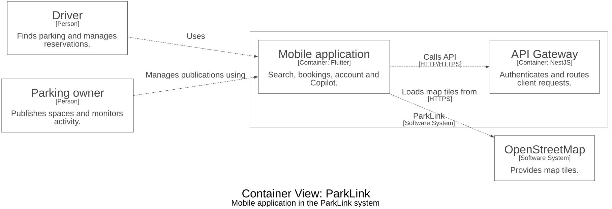

# Mobile application

Flutter client for finding parking, booking spaces and managing a ParkLink account.

## Responsibilities

- Provides a map-first experience, search, bookings, profile and Copilot.
- Calls the Gateway and loads OpenStreetMap tiles.
- The repository includes legacy transport source but the ParkLink entry point is lib/main.dart.

## Technology

Flutter, Dart, flutter_map.

## C4 architecture

The diagram is a C4 **container view** focused on this repository and its relevant neighbors. It is generated from [Structurizr DSL](docs/architecture/workspace.dsl) using default styles, without custom colors. Arrows show the direction of an interaction; the full model also records message flows.



To inspect or regenerate the diagram, open `docs/architecture/workspace.dsl` in Structurizr. With the Structurizr CLI and Graphviz installed:

```sh
structurizr.sh validate -workspace docs/architecture/workspace.dsl
mkdir -p /tmp/parklink-diagram
structurizr.sh export -workspace docs/architecture/workspace.dsl -format dot -output /tmp/parklink-diagram
dot -Tsvg /tmp/parklink-diagram/structurizr-Containers.dot -o docs/architecture/containers.svg
```

## Run locally

```sh
flutter pub get
flutter run --dart-define=PARKLINK_API_URL=http://localhost:3000
flutter test
```

Use `10.0.2.2` instead of `localhost` for the Android emulator. Firebase configuration and signing credentials are excluded; provide your own when required. Legacy Google Maps features require a restricted `GOOGLE_MAPS_API_KEY` supplied with `--dart-define`.

## Repository boundary

This repository is the source of the ParkLink mobile application. The backend, owner dashboard, and local infrastructure are available in [parklink-platform](https://github.com/1ASI0728-2620-16363-ParkLink/parklink-platform). The mobile source is maintained here, not in the platform workspace.
